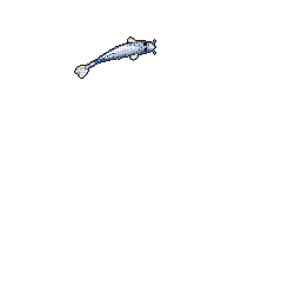

# Hi, I'm Hasan Turan 👋

Electrical engineering student working on power electronics and battery systems.

- ⚡ Final-year project: bidirectional dual active bridge (DAB) converter
- 🔋 Battery management system and battery pack design

Koi drawn by [git-koi](https://github.com/yalongwastaken/git-koi).
